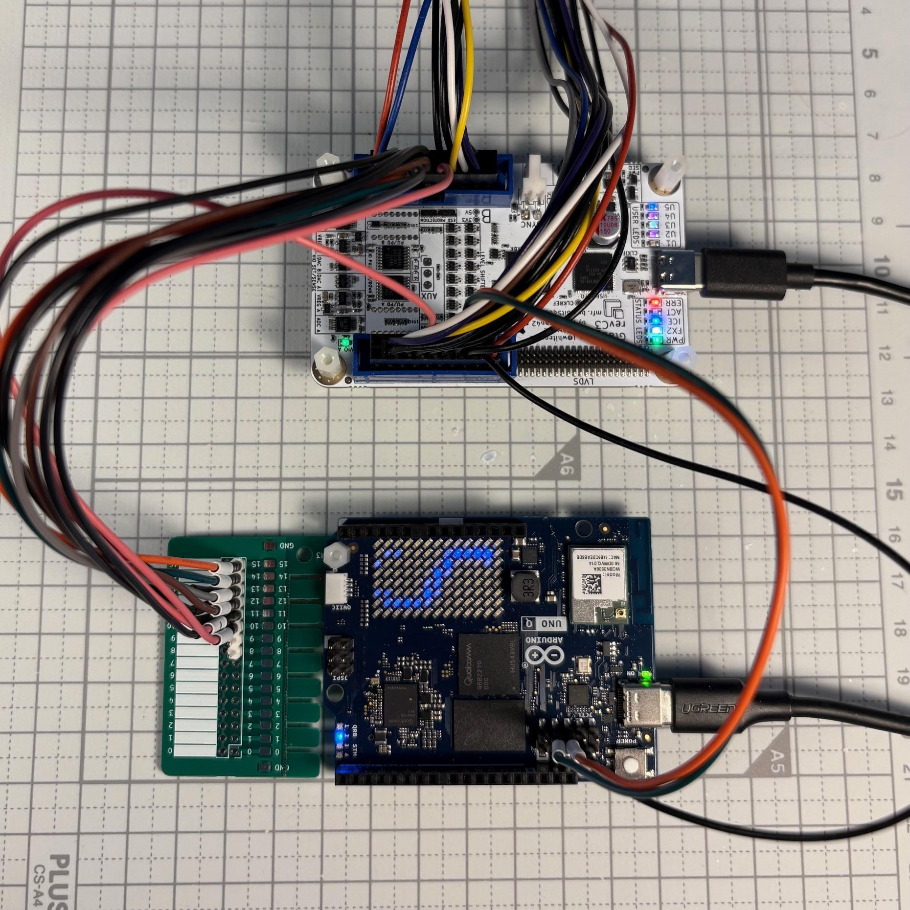

# Ashen Uno Q Development Tools

This repository contains a collection of test scripts used during development of ashen-firmware on an [arduino uno
Q](https://docs.arduino.cc/hardware/uno-q/). You should not need any of these to run ashen, but some of them may be
helpful when debugging things yourself.

These scripts assume that the uno Q is wired to a glasgow debug multitool as [described
here](https://jaseg.de/blog/arduino-uno-q-kernel-debugging/). The glasgow can reset the board, access the SoC's JTAG,
and access the SoC's UART.

> [!NOTE]
> Most of these scripts are LLM-generated. Since they are debug tools only and not critical infrastructure, we don't see
> any issue with that but please keep it in mind before reading them.

## AI Policy

See [our AI policy in our docs](https://ashen.yasec.de/docs/ai-policy/).

## Contact

You can find contact information for the project at [https://ashen.yasec.de/](https://ashen.yasec.de/). For
security-related issues, you can contact project lead jaseg at [ashen@yasec.de](mailto:ashen@yasec.de).

## Funding

This project has been funded by [Prototype Fund](https://www.prototypefund.de/) as part of the [ashen project](https://www.prototypefund.de/projects/ashen).

